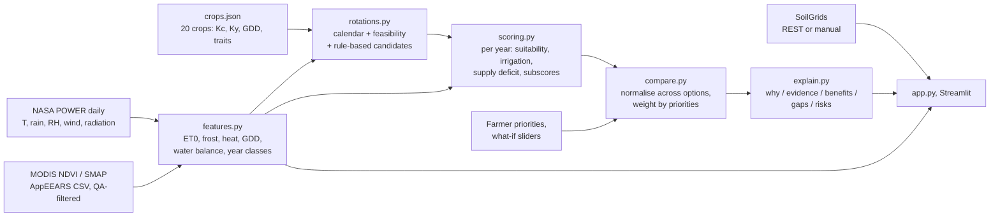

# Field Shift: crop-rotation decision support with NASA data

NASA Space Apps Challenge 2026, challenge **"Field Shift: Adapting Farms with NASA Data"**.

Field Shift helps a farmer explore crop-rotation options for any point on Earth (latitude/longitude). It combines
NASA climate and satellite data with soil data, crop traits and the farmer's own priorities, and compares **the
current rotation with rule-generated alternatives**: why each was suggested, the numbers behind it, benefits,
information gaps and risks that need a local expert. It **supports and does not replace** the judgment of farmers
and agronomists.

Three **regional farmland presets** (Karakalpakstan near Nukus 42.41°N 59.52°E, Bukhara region 39.99°N 64.32°E, Samarkand region 39.64°N 67.06°E) use the same
code and are cached for offline use. Their points were chosen on OpenStreetMap farmland polygons of 160+ ha, away from town centres, where
SoilGrids returns values. **No MODIS NDVI or SMAP was requested for the presets** (the gaps section says so), and their default rotation
(winter wheat → cotton) is an assumption to review locally: rice, vegetables and orchards are not in the crop list.

Default demo fields: **Fergana Valley, Uzbekistan** (40.43°N, 71.70°E; winter wheat → cotton; water scarcity) and **central Kansas, USA**
(38.50°N, 98.50°W; maize → soybean). The Fergana point is farmland about 7 km west of Fergana city: the city centre itself is inside
the urban mask where SoilGrids returns no data. Both points sit in the same NASA POWER grid cell, so the climate is the same.

## Quick start

Python 3.11+ (developed and deployed on 3.12). On Fedora:

```bash
python3.12 -m venv .venv
.venv/bin/pip install -r requirements-dev.txt   # requirements.txt = app only (pinned); -dev adds pytest
.venv/bin/streamlit run app.py                  # open http://localhost:8501
.venv/bin/pytest -q                             # unit tests
```

**The two demo fields work with no network.** Their NASA POWER downloads (and the Kansas SoilGrids values) are committed
under `data/demo_cache/` and are read first; the end year is pinned to 2025 for them so the cache keys never go stale.
Any other location is downloaded from NASA POWER (no account needed, about a minute the first time) and cached under
`data/cache/` (git-ignored). `scripts/prewarm.py` downloads and caches the demo fields again and reports what is missing.
Command-line reports (no UI): `scripts/field_report.py fergana`, `scripts/rotation_report.py kansas --rain -20 --temp 2`,
`scripts/checks.py` (scoring balance, irrigation supply and ET0 audits), `scripts/app_smoke.py` (headless UI test).

### Optional data you add by hand

- **MODIS NDVI and SMAP via the AppEEARS API** (needs a free NASA Earthdata account that has accepted the AppEEARS terms):
  `cp .env.example .env`, fill in `EARTHDATA_USERNAME` and `EARTHDATA_PASSWORD` (`.env` is git-ignored), then
  `.venv/bin/python scripts/appeears_fetch.py run`. It checks the product and layer names against the API, submits one point
  task for both demo fields (MOD13Q1.061 NDVI + pixel reliability; SPL3SMP_E.006 AM soil moisture + retrieval quality flag;
  2015-04-01 to today), polls until it is done and saves the `*-results.csv` files into `data/raw/`. Credentials are used only for
  the login request and never printed. (`verify`, `submit`, `status`, `download` run the steps separately.)
- **Or by hand**: put the AppEEARS point-sample `*-results.csv` files from the web interface in `data/raw/` (`data/` is scanned too).
  File names must contain `MOD13Q1` (MOD13Q1.061; `NDVI` plus `VI_Quality` and/or `pixel_reliability`) or `SPL3SMP`
  (SPL3SMP_E.006; AM soil moisture and `retrieval_qual_flag`). **The point must be the field itself**: NDVI is matched within
  ~1 km and SMAP within ~6 km, so a town-centre point (an urban pixel with low, flat NDVI) is never silently used for a farm.
  Quality layers are applied before use (see `docs/methodology.md`). If a file is missing, too far, or every observation fails QA,
  the app still runs and lists the reason as an information gap. The parser is tested on subsets of a real AppEEARS download.
- **Soil**: SoilGrids REST is tried first (10 s timeout). If it returns nothing, fill `data/manual/soil_<field>.json`
  (values read by hand from the SoilGrids web map, 0–30 cm); the source is then shown as "SoilGrids web map, read manually".

## Deploy on Streamlit Community Cloud

1. Push this repo to GitHub (it needs `app.py`, `requirements.txt`, `.streamlit/config.toml`, `src/` and `data/demo_cache/`).
2. Sign in at <https://share.streamlit.io> with GitHub and authorise access to the repository (private repos work after you grant access).
3. Click **Create app** → **Deploy a public app from GitHub**; choose the repository, branch `master`, and set
   **Main file path** to `app.py`.
4. Open **Advanced settings** and choose **Python 3.12**. No secrets are needed.
5. Click **Deploy**. The first build installs the pinned `requirements.txt` (a few minutes). The demo fields then load from
   the committed cache without calling any external service.
6. Share the `*.streamlit.app` link. Notes: the app's disk is temporary, so anything downloaded for a custom location is
   lost when the app restarts; the app sleeps after inactivity and wakes on the next visit. Custom locations call NASA POWER live.

## How it works



Project layout: `src/fieldshift/fetch/` (one module per source, each returning data plus provenance and a success
flag), `features.py`, `crops.json` (generated by `scripts/build_crops.py`), `rotations.py`, `scoring.py`, `compare.py`,
`explain.py`, `pipeline.py`, `viz.py`, `app.py`, `docs/methodology.md`, `tests/`.

## Languages

The sidebar has an **English / O'zbekcha** switch (labels, summaries, chart text, glossary, crop names). Switching keeps your field, view and settings.
Not translated: the long evidence / information-gap / risk bullets inside the option cards (the UI says so). All Uzbek text was written by the AI
assistant and **needs review by a native speaker**: see `docs/uzbek_review.md` (generated by `scripts/uzbek_review.py`; uncertain strings are listed first).

## What the tool shows

1. **Your field**: map, key climate numbers and trends, rain vs ET0, frost and heat calendar, bare periods (satellite
   NDVI when available, otherwise the crop calendar), when current crops are most vulnerable, soil, and data gaps.
2. **Rotation options**: the current rotation plus up to four alternatives side by side, each with a relative
   "Fit to your priorities (compared among these options)", real units (irrigation mm and % change, bare days, nitrogen kg/ha,
   yield at risk from water shortage, hot days in season), a radar of the six priorities, and expandable
   Why / Evidence / Benefits / Gaps / Risks. Score ranges are shown for dry, normal and wet years.
3. **Glossary & data**: plain-language terms, datasets used, and satellite-versus-ground caveats.

Sidebar: field and current rotation, six priority sliders (water saving, soil organic matter, nitrogen fixing, erosion
reduction, forage value, market/income), and what-if sliders (rainfall −30…+20%, temperature +0…+3 °C, irrigation water
available 40…100%).

## Honest limits

- Fit is a **relative** ranking among the options shown, not a grade or a yield forecast. **Three of the six priorities are
  soil criteria**, so with equal sliders soil carries half of the weight; see `docs/methodology.md` section 7.
- Climate comes from a ~50 km reanalysis that probably runs hot over irrigated land; crop parameters are regional
  approximations and several are unverified estimates (flagged `approx` in `crops.json` and in the UI).
- Irrigation supply, salinity, slope, machinery and prices are not observed. Uncertainty ranges reflect weather variability only.
- Not implemented: GPM IMERG and SRTM, the Uzbek-language UI, the optional LLM rewording of explanations, the AppEEARS API fallback.
- What-if sliders recompute only when you press **Apply what-if** (about a second; repeats are cached).

## Data, credits and AI tools

- **NASA POWER** (MERRA-2 / CERES-SYN daily point data), **NASA MODIS MOD13Q1** and **SMAP SPL3SMP_E** (via NASA AppEEARS),
  **ISRIC SoilGrids**, and FAO Irrigation and Drainage Papers 56 and 33/66 for ET0, crop coefficients and yield-response factors.
- Built with Python, pandas, NumPy, Streamlit, Plotly and Folium.
- **AI tools used:** the code, tests and documentation were written with Claude Code (Anthropic's Claude Sonnet 5.5)
  under the developer's direction; the developer reviews the results. Crop parameters marked approximate were drafted by the AI from
  general knowledge and partly checked against FAO tables as described in `docs/methodology.md`.
